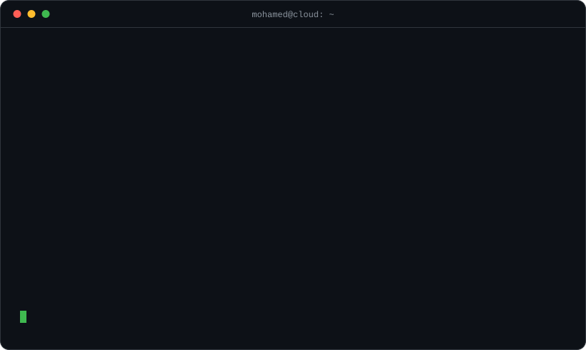
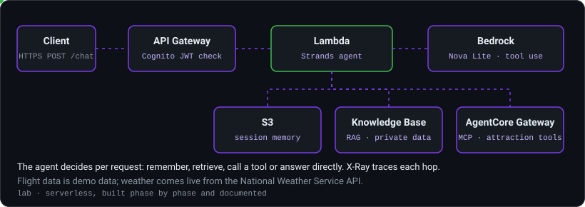
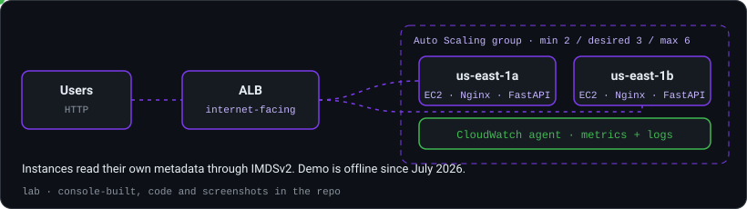
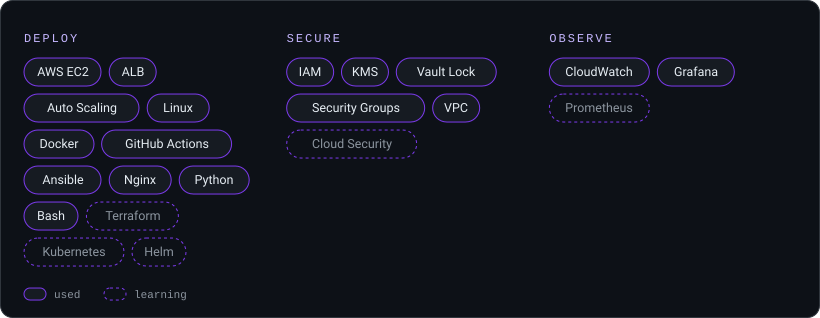

# ⚡ Mohamed Elhadad

### DevOps Engineer @ ALGOcas • AWS Certified Solutions Architect • AI Student

Building cloud-native infrastructure, automating workflows, and exploring secure, scalable systems.

🔭 **Now:** building agentic AI on AWS (Bedrock, Strands) · learning Terraform and Kubernetes

---

# 🖥️ Terminal

---

# 💼 Experience

**DevOps Engineer — ALGOcas** · Sept 2026 – Present
Working on cloud infrastructure, CI/CD automation, and deployment workflows.

**DevOps Trainee — DEPI** (Digital Egypt Pioneers Initiative)
Hands-on training in Linux, AWS, Docker, Kubernetes, and CI/CD.

---

# 🧪 Projects

### [AWS-Agentic-Travel-Assistant](https://github.com/mohamed-ibrahim09/AWS-Agentic-Travel-Assistant)

**Lab.** A serverless AI travel agent built in phases with the Strands Agents SDK: tool use, live weather from the National Weather Service API, S3-backed session memory, RAG over a Bedrock knowledge base, MCP tools through AgentCore Gateway, and a Cognito-protected REST API traced with X-Ray. Flight data is demo data.

`Strands Agents` `Bedrock` `Lambda` `MCP` `Cognito`

### [AWS-Cloud-Infrastructure-Dashboard](https://github.com/mohamed-ibrahim09/AWS-Cloud-Infrastructure-Dashboard)

AMI, launch template and Auto Scaling group behind an internet-facing ALB across two AZs, with a FastAPI and React app behind Nginx.

More: [AWS](https://github.com/mohamed-ibrahim09/AWS) (study notes and console labs) · [Blockchain-like-Tamper-Proof](https://github.com/mohamed-ibrahim09/Blockchain-like-Tamper-Proof) (team of 6; my part: Playfair cipher, frontend, backend, deployment) · [all repositories](https://github.com/mohamed-ibrahim09?tab=repositories)

---

# 🛠️ Tech Stack

---

# 📜 Certifications & Training

- ☁️ AWS Certified Solutions Architect – Associate (SAA-C03)
- 🎓 NTI Summer Training — Cloud Architecture (completed)
- 🎓 NTI — CCNAv7 curriculum (completed)
- 🎓 DEPI DevOps Program (completed)
- 🌐 GCI World 2026 — Matsuo-Iwasawa Lab, University of Tokyo (program)

---

# 🐍 Activity

<picture>
  <source media="(prefers-color-scheme: dark)" srcset="https://raw.githubusercontent.com/mohamed-ibrahim09/mohamed-ibrahim09/output/github-contribution-grid-snake-dark.svg">
  
</picture>

---

*"Build systems that scale, automate what repeats, and secure what matters."*

