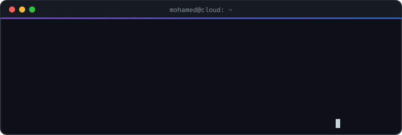
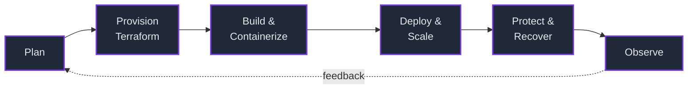

<div align="center">



### DevOps Engineer @ ALGOcas • AWS Certified Solutions Architect • AI Student

Building cloud-native infrastructure, automating workflows, and exploring secure, scalable systems.

<p>
<a href="https://linkedin.com/in/mohamed-ibrahim-elhadad">

</a>
<a href="mailto:mohammed.i.elhadad@gmail.com">

</a>
<a href="https://mohamedelhadad.vercel.app">

</a>
</p>

</div>

---

# 🖥️ Terminal

```bash
$ whoami

  Mohamed Ibrahim Elhadad
  DevOps Engineer @ ALGOcas
  AI Student, Menofia University (Class of 2027)

$ now

  Cloud infrastructure, CI/CD automation and deployment workflows at ALGOcas

$ focus

  Cloud Computing · Infrastructure as Code · Containerization
  DevOps Automation · Observability · Cloud Security

$ currently_learning

  Kubernetes · Prometheus · Cloud Security
```

---

# 🔁 How I ship



Where I have done it end to end, with screenshots and a written walkthrough:

| Stage | Proof |
|---|---|
| Deploy & Scale | [AWS Cloud Infrastructure Dashboard](https://github.com/mohamed-ibrahim09/AWS-Cloud-Infrastructure-Dashboard) |
| Protect & Recover | [AWS Backup & Disaster Recovery](https://github.com/mohamed-ibrahim09/aws-backup-disaster-recovery) |
| Build & Automate (serverless, AI) | [Agentic Travel Assistant](https://github.com/mohamed-ibrahim09/AWS-Agentic-Travel-Assistant) |
| Observe | CloudWatch agent, logs and metrics in the [Dashboard](https://github.com/mohamed-ibrahim09/AWS-Cloud-Infrastructure-Dashboard) project |

---

# 🚀 Featured projects

### 🛡️ [AWS Backup & Disaster Recovery](https://github.com/mohamed-ibrahim09/aws-backup-disaster-recovery)

Backs up a tagged production EC2 instance with AWS Backup, encrypts the recovery points with a customer-managed KMS key, applies Vault Lock, copies the backup to a second Region, then **restores the workload in us-west-1 and validates it** (data file, Nginx and an HTTP 200 response).

`AWS Backup` · `KMS` · `Vault Lock` · `Cross-Region copy` · `EC2` · `Nginx`

### 🤖 [Agentic Travel Assistant](https://github.com/mohamed-ibrahim09/AWS-Agentic-Travel-Assistant)

A serverless AI agent built with the Strands Agents SDK. It runs on Lambda with Bedrock (Nova Lite), answers from a private knowledge base (RAG), keeps session memory in S3, calls MCP tools through AgentCore Gateway, and sits behind API Gateway with Cognito auth and X-Ray tracing.

`Lambda` · `Bedrock` · `Knowledge Bases` · `API Gateway` · `Cognito` · `X-Ray`

### 🌐 [AWS Cloud Infrastructure Dashboard](https://github.com/mohamed-ibrahim09/AWS-Cloud-Infrastructure-Dashboard)

A React and FastAPI app built into a golden AMI and served from EC2 instances behind an Application Load Balancer across two Availability Zones, scaled by an Auto Scaling Group, with an HTTPS listener and CloudWatch agent logs and metrics. Every step is documented with screenshots.

`EC2` · `ALB` · `Auto Scaling` · `ACM` · `CloudWatch` · `Nginx`

---

# 🛠️ Tech stack

**Cloud & IaC**


**CI/CD & Automation**


**Containers & Orchestration**


**Observability**


**Languages**


**Security:** AWS IAM · KMS · Backup Vault Lock · Cognito · Network fundamentals (CCNA)

---

# 💼 Experience

**DevOps Engineer — ALGOcas** · Sept 2026 – Present
Working on cloud infrastructure, CI/CD automation, and deployment workflows.

**DevOps Trainee — DEPI** (Digital Egypt Pioneers Initiative)
Hands-on training in Linux, AWS, Docker, Kubernetes, and CI/CD.

---

# 📜 Certifications

- ☁️ AWS Certified Solutions Architect – Associate (SAA-C03)
- 🎓 CCNA — NTI Networking Internship
- 🎓 DEPI DevOps Program
- 🎓 GCI World 2026 — Matsuo-Iwasawa Lab, University of Tokyo

---

# 🐍 Contribution graph

<div align="center">

<picture>
  <source media="(prefers-color-scheme: dark)" srcset="https://raw.githubusercontent.com/mohamed-ibrahim09/mohamed-ibrahim09/output/github-contribution-grid-snake-dark.svg">
  <source media="(prefers-color-scheme: light)" srcset="https://raw.githubusercontent.com/mohamed-ibrahim09/mohamed-ibrahim09/output/github-contribution-grid-snake.svg">
  
</picture>

</div>

---

# 📊 GitHub stats

<div align="center">


</div>

---

# 📬 Let's connect

- 💼 [LinkedIn](https://linkedin.com/in/mohamed-ibrahim-elhadad)
- 🌐 [Portfolio](https://mohamedelhadad.vercel.app)
- ✉️ [mohammed.i.elhadad@gmail.com](mailto:mohammed.i.elhadad@gmail.com)

<div align="center">

*"Build systems that scale, automate what repeats, and secure what matters."*

</div>
